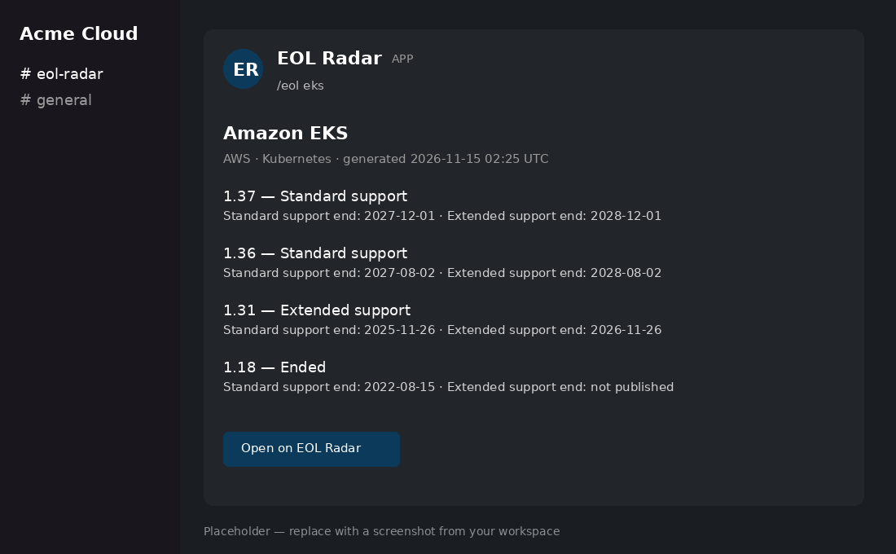

# EOL Radar Bot

A Slack bot for [EOL Radar](https://eolradar.dev/) end-of-support dates. Ask `/eol` about a cloud service, or let a Monday digest post what is ending in the next 90 days.

You can run it as a Cloudflare Worker, or self-host it. The self-hosted process does not use Cloudflare. See [Deployment options](#deployment-options).

The only data source is the public JSON API at [https://eolradar.dev/api/v1/](https://eolradar.dev/api/v1/). There is no API key. Each document has `schema_version` `"1"` and `generated_at`, and the API asks clients to cache responses for `max-age=300`.

Dates are a planning aid. Confirm them with the provider before you upgrade or set a budget. EOL Radar says so too: the official provider page is the authority.



The image above is a placeholder. After you install the app, replace `docs/screenshot.png` with a capture of `/eol eks`.

## What you can ask

| Command | Result |
| --- | --- |
| `/eol` | Every service, with the slug to use next time |
| `/eol eks` | Versions, standard and extended support end dates, status, and a link to the service page |
| `/eol rds-postgres` | Fuzzy match. This resolves to Amazon RDS for PostgreSQL (`rds-postgresql`) |
| `/eol upcoming` | Standard or extended support ending within 90 days |
| `/eol upcoming 30` | Same list for 30 days. `180` is the other window |

Names are matched loosely: case, hyphens, and `postgres` versus `postgresql` all work. If several services fit, the bot asks you to pick a slug.

Statuses are the ones EOL Radar publishes: standard support, extended support, ended, or unknown (the provider has not published a date). A month with no day, such as `2026-11`, means the last day of that month.

## Weekly digest

The Worker cron runs at **14:00 UTC every Monday**. It posts to `SLACK_DIGEST_CHANNEL` what is hitting end of standard or extended support in the next 90 days. The self-hosted process uses the same schedule. Enable one of them. Set `DIGEST_CRON=off` on the self-hosted process when the Worker posts, or clear `triggers.crons` in `wrangler.jsonc` when the self-hosted process posts.

`DIGEST_SERVICES` is an optional comma-separated list of slugs (`eks,rds-postgresql,lambda`). Set it to `all`, or leave it empty, to include every service. Unknown slugs are called out in the message so a typo is visible.

If the channel is empty, the cron logs a skip and does not post. Invite the bot to the channel (`/invite @EOL Radar`) or Slack will reject the post.

The Workers Free plan includes Cron Triggers (five per account). This job mostly waits on the API, which does not count as CPU time. If a Free-plan cron is terminated for CPU, use the [GitHub Actions schedule](#github-actions-instead-of-the-cron) instead and remove the cron from `wrangler.jsonc` so the digest is not sent twice.

## How it is split

```text
src/core       API client, /eol parsing, name matching, BotMessage, Block Kit
src/slack      request signatures, slash-command HTTP, Socket Mode, chat.postMessage
src/app.ts     /health, /healthz, /readyz, and /slack/commands
src/index.ts   Cloudflare Worker adapter (fetch and the Monday cron)
src/node       Node.js HTTP server, environment, in-process scheduler
src/store      memory, JSON file, and SQLite stores for the self-hosted process
```

`BotMessage` is not Slack-specific. `src/core/block-kit.ts` is the Slack renderer. A Microsoft Teams adapter can call `runCommand` (`src/core/commands.ts`) and `buildDigest` (`src/core/digest.ts`) and render the same message as an Adaptive Card, without changing the API client or the matcher.

Slash-command replies are ephemeral (only the person who asked sees them). The digest is a normal channel message.

## Deployment options

| Mode | What runs |
| --- | --- |
| [Cloudflare Workers](#setup) | `wrangler deploy`. Cron Triggers and the Cache API stay on Cloudflare. |
| [Script](docs/self-hosting.md#script) | `npm run build && npm start` on a machine with Node.js 22. A systemd unit is in `deploy/systemd/`. |
| [Container](docs/self-hosting.md#container) | `docker compose up`. The image is `ghcr.io/fjcruzer/eolradar-bot`. |
| [Kubernetes / Helm](docs/self-hosting.md#kubernetes-and-helm) | `deploy/kubernetes/` and `deploy/helm/eolradar-bot`. |

Self-hosted mode has no Cloudflare dependency. The process only makes outbound HTTPS calls to Slack and `https://eolradar.dev`. Socket Mode adds an outbound WebSocket to Slack, so the bot does not need a public request URL. Step-by-step setup, including the Slack app differences, is in [docs/self-hosting.md](docs/self-hosting.md).

Enable one Monday scheduler: the Worker cron, the self-hosted process, or the GitHub Actions workflow.

## Setup

These steps deploy the Cloudflare Worker. For a host with no Cloudflare account, use [docs/self-hosting.md](docs/self-hosting.md) instead.

You need Node.js 22 or newer, a free [Cloudflare Workers](https://workers.cloudflare.com/) account, and a Slack workspace where you can create apps.

These steps need your accounts. The repository does not contain tokens.

### 1. Install and check the project

```bash
npm ci
npm test
```

### 2. Deploy the Worker and copy its URL

```bash
npx wrangler login
npx wrangler deploy
```

`wrangler login` opens a browser and authorizes Wrangler against your Cloudflare account. The deploy prints a URL like `https://eolradar-bot.<account>.workers.dev`. The slash command endpoint is that host plus `/slack/commands`.

`wrangler deploy` needs a Cloudflare API token if you are not using `wrangler login`. Create one with the **Workers Scripts: Edit** permission (account resource). Wrangler reads it from the `CLOUDFLARE_API_TOKEN` environment variable. Do not commit the token.

The first deploy can succeed before the Slack secrets exist. The command will answer 500 until the signing secret is set, and the digest will skip until a channel and bot token are set.

### 3. Create the Slack app from the manifest

1. Open [https://api.slack.com/apps](https://api.slack.com/apps) and choose **Create New App** → **From a manifest**.
2. Pick the workspace.
3. Paste `slack-app-manifest.yml`, after replacing `eolradar-bot.example.workers.dev` with the host from step 2.
4. Create the app, then **Install to Workspace** and allow the `commands` and `chat:write` scopes.

If you already created the app with the placeholder host, change the Request URL under **Slash Commands** to `https://<your-worker-host>/slack/commands` and reinstall if Slack asks you to.

### 4. Set the Worker secrets

From the Slack app:

- **Basic Information** → **Signing Secret**
- **OAuth & Permissions** → **Bot User OAuth Token** (`xoxb-...`)

The digest channel id is in Slack: right-click the channel, **View channel details**, and copy the id at the bottom (`C0123ABCDEF`).

```bash
npx wrangler secret put SLACK_SIGNING_SECRET
npx wrangler secret put SLACK_BOT_TOKEN
npx wrangler secret put SLACK_DIGEST_CHANNEL
npx wrangler secret put DIGEST_SERVICES
```

Paste each value when prompted. Wrangler does not take the secret on the command line. For `DIGEST_SERVICES`, submit `all` to track every service, or a list such as `eks,rds-postgresql`.

`npx wrangler secret put` stores the value as a Worker secret and deploys a new version. Nothing is written to the repo.

Local development uses a gitignored file:

```bash
cp .dev.vars.example .dev.vars
npx wrangler dev
```

`GET /health` returns `{"ok":true}` and does not check Slack.

### 5. Try it

Invite the bot to the digest channel, then in Slack:

```text
/eol
/eol eks
/eol upcoming 30
```

To fire the digest once without waiting for Monday:

```bash
curl "http://localhost:8787/cdn-cgi/local/scheduled"
```

while `wrangler dev` is running, with `.dev.vars` filled in. Against the deployed Worker, use the Cloudflare dashboard: **Workers & Pages** → **eolradar-bot** → **Settings** → **Triggers** → **Cron Triggers**, or the local command above.

## GitHub Actions instead of the cron

`examples/weekly-digest.github-workflow.yml` runs the same digest from GitHub at 14:00 UTC on Mondays. Copy it to `.github/workflows/weekly-digest.yml`, add repository secrets `SLACK_BOT_TOKEN` and `SLACK_DIGEST_CHANNEL`, and optional variable `DIGEST_SERVICES`. Then set `triggers.crons` in `wrangler.jsonc` to `[]` and redeploy so Cloudflare does not also post.

## Configuration

| Name | Where | Purpose |
| --- | --- | --- |
| `EOL_API_BASE` | `wrangler.jsonc` `vars` | API origin. Default `https://eolradar.dev` |
| `SLACK_SIGNING_SECRET` | Worker secret | Verifies `X-Slack-Signature` |
| `SLACK_BOT_TOKEN` | Worker secret | `chat.postMessage` for the digest |
| `SLACK_DIGEST_CHANNEL` | Worker secret | Channel id. Empty skips the digest |
| `DIGEST_SERVICES` | Worker secret | Comma-separated slugs. `all` or empty means every service |

Self-hosted mode reads the same Slack and API names from the environment, plus `PORT`, `STORE`, `DIGEST_CRON`, and `SLACK_APP_TOKEN`. The full list is in [docs/self-hosting.md](docs/self-hosting.md).

The bot checks the Slack timestamp is within five minutes and compares the HMAC with a fixed-time equality check. A bad signature gets HTTP 401. API failures become a short ephemeral message instead of a stack trace. Responses are cached for the `Cache-Control` `max-age` (300 seconds when the header matches the API docs). HTTP errors and `schema_version` other than `"1"` are not cached.

## Development

```bash
npm test
npm run lint
npm run typecheck
```

CI on pull requests runs those three. See [CONTRIBUTING.md](CONTRIBUTING.md).

## License

[MIT](LICENSE). Copyright (c) 2026 Aris Cruz.
